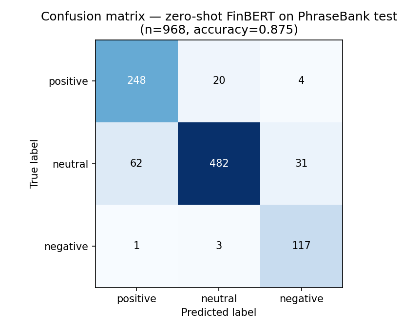
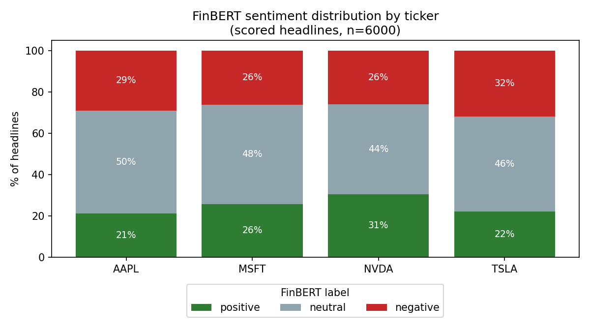
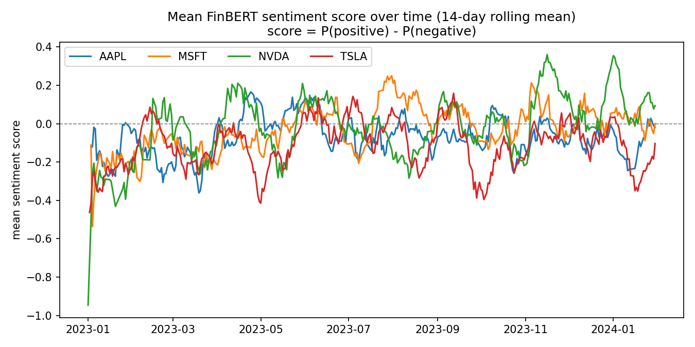
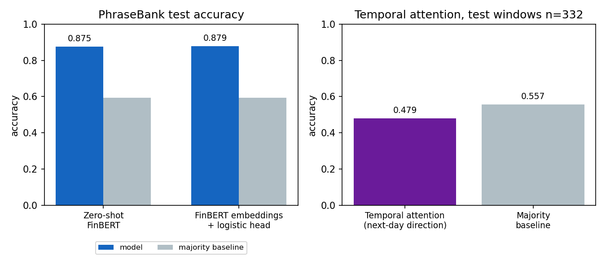

# Stock Sentiment Analysis Pipeline — FinBERT + PyTorch

**Author:** Muhammad Talha Zahid (github.com/tzmughal)
**Tickers:** AAPL, MSFT, NVDA, TSLA
**Status:** working pipeline, tested end to end on CPU. The CV line for this
project can now drop "(in progress)" for the sentiment pipeline itself — see
[What remains](#what-remains) for the parts that are still open.

## What this is

A small, honest pipeline that:

1. scores financial text with **pretrained FinBERT** (`ProsusAI/finbert`,
   Araci 2019),
2. evaluates it on the labelled **Financial PhraseBank**,
3. trains a classifier head on frozen FinBERT embeddings (see the scope note
   below — this is *not* full end-to-end fine-tuning),
4. scores 6,000 real news headlines for AAPL / MSFT / NVDA / TSLA,
5. feeds daily sentiment into a **PyTorch temporal attention model** that
   predicts next-day price direction — and reports that it does **not** beat
   a majority baseline (a real, negative result).

No number in this README is invented. Every figure comes from the run on
16 November 2026 described in [Test run](#test-run); the raw outputs are in
`data/processed/` and `results/`.

## Results (verified, 16 Nov 2026)

### FinBERT on Financial PhraseBank — held-out test set, n = 968

| Model | Accuracy | Majority baseline |
|---|---|---|
| Pretrained FinBERT, zero-shot | **0.875** | 0.594 |
| Logistic head on frozen FinBERT [CLS] embeddings | **0.879** | 0.594 |

Per-class F1 (zero-shot FinBERT): positive **0.851**, neutral **0.893**,
negative **0.857**. The trained head barely improves on zero-shot
(+0.004) — the pretrained model already captures most of the signal.



### Headlines scored — 6,000 real headlines, 1,500 per ticker

| Ticker | Positive | Neutral | Negative | Mean score* |
|---|---|---|---|---|
| AAPL | 318 (21%) | 747 (50%) | 435 (29%) | −0.070 |
| MSFT | 386 (26%) | 722 (48%) | 392 (26%) | +0.001 |
| NVDA | 458 (31%) | 653 (44%) | 389 (26%) | +0.020 |
| TSLA | 333 (22%) | 689 (46%) | 478 (32%) | −0.092 |
| **All** | **1,495 (25%)** | **2,811 (47%)** | **1,694 (28%)** | **−0.035** |

\* Mean score = mean of P(positive) − P(negative) per headline, in [−1, 1].





### Temporal attention model — next-day direction

5-day windows of daily features (mean sentiment, positive/negative share,
headline count, daily return) → learned softmax attention over the 5 days →
up/down next day. Time-based split: train on target dates up to 2023-09-30
(710 windows), test after (332 windows).

| | Test accuracy |
|---|---|
| Temporal attention model | **0.479** |
| Train accuracy (same model) | 0.545 |
| Majority baseline (always "up") | 0.557 |

The model **does not beat the majority baseline** on the test period, and
its mean attention weights are uniform (0.20 on each of the 5 days) — it
learned no useful temporal weighting. This matches the known finding that
news sentiment correlates with *same-day* returns but barely predicts the
*next* day. It is reported as-is; this is not a trading signal.



## Test run

Run on this machine (Python 3.12.3, torch 2.15.0+cpu, transformers 5.23.0,
scikit-learn 1.9.1, 1.5 shared vCPUs, ~1 GB RAM available):

- **PhraseBank:** `Sentences_50Agree.txt` — 4,845 sentences, 4,838 unique
  after de-duplication. Stratified 80/20 split (seed 42): train 3,870
  (neutral 2,297 / positive 1,090 / negative 483), test 968 (neutral 575 /
  positive 272 / negative 121).
- **Headlines:** raw files 160,436 rows (AAPL 58,398; MSFT 36,816;
  NVDA 20,722; TSLA 44,500), dates 2014-11-07 to 2024-01-30. Filtered to
  2023-01-01–2024-01-30 (50,379 rows), de-duplicated by headline
  (12,578 left — ~75% were wire duplicates), seeded sample of 1,500 per
  ticker = **6,000 headlines**. Daily aggregates: 1,388 ticker-days
  (4.3 headlines/day on average, range 1–16).
- **Prices:** 271 trading days per ticker, 2023-01-01–2024-01-30, via Yahoo
  Finance's chart API. Daily sentiment + price overlap: 1,062 ticker-days.
- **FinBERT inference:** 968 test sentences in 199.1 s (4.9 texts/s);
  6,000 headlines in 1,189.2 s (5.0 texts/s); embeddings for 4,838
  sentences in 933.5 s (all CPU).
- **Reproducibility:** `python run_pipeline.py --skip-scoring` re-runs the
  whole pipeline from the saved scored files (verified after the main run).

## Data sources

- **Financial PhraseBank** (Malo et al. 2014): `data/raw/FinancialPhraseBank-v1.0.zip`,
  mirrored on Hugging Face as `takala/financial_phrasebank`. Licence file
  included in the zip. Used file: `Sentences_50Agree.txt`.
- **Headlines:** `David-Chew-HL/Tech-Stocks-News` on Hugging Face, files
  `{AAPL,MSFT,NVDA,TSLA}_Alpaca_NLP.csv` (Alpaca news headlines, columns
  `headline, date`). The four raw CSVs total ~535 MB and are **not**
  committed; fetch them with `python src/download_news.py`.
- **Prices:** Yahoo Finance chart API (`query1.finance.yahoo.com`), no key.

## Model notes — read before reusing the numbers

- **Label order is unusual in this checkpoint.** `ProsusAI/finbert`'s own
  `config.id2label` is `{0: positive, 1: negative, 2: neutral}` — not the
  commonly documented `{0: negative, 1: neutral, 2: positive}`. The code
  reads the label order from the model config instead of assuming it, and
  the probabilities were verified to sum to 1.
- **Scope of "fine-tuning".** The classifier-head experiment freezes the
  BERT encoder and trains only a logistic-regression head on the 768-d
  [CLS] embedding. Full end-to-end fine-tuning of all ~110M parameters was
  **not** run — this machine's ~1 GB of available RAM cannot hold Adam
  optimiser states for 110M parameters. The README and code say this
  explicitly; do not describe the head experiment as full fine-tuning.
- **The temporal attention model is genuinely implemented and run**
  (`src/temporal_attention.py`, PyTorch, 60 epochs, Adam lr 1e-3). Its
  negative result is part of the project, not a failure to run it.
- **Sampling is documented, not hidden.** Only 6,000 of 12,578
  de-duplicated in-range headlines were scored, because CPU inference runs
  at ~5 texts/s. The sampling (seed 42) and the counts at each filtering
  step are in `data/processed/news_sample_counts.json`.

## How to run

```bash
python -m venv --system-site-packages .venv
source .venv/bin/activate
pip install torch --index-url https://download.pytorch.org/whl/cpu
pip install -r requirements.txt
# FinBERT weights (~418 MB) — resumable download, or let transformers fetch them:
mkdir -p models/finbert
curl -L -C - -o models/finbert/model.safetensors \
  https://huggingface.co/ProsusAI/finbert/resolve/main/model.safetensors
for f in config.json vocab.txt tokenizer_config.json special_tokens_map.json; do
  curl -sL -o models/finbert/$f \
    https://huggingface.co/ProsusAI/finbert/resolve/main/$f
done
python src/download_news.py        # ~535 MB into data/raw/ (git-ignored)
python run_pipeline.py             # full run (FinBERT scoring takes ~25 min on CPU)
python run_pipeline.py --skip-scoring   # re-run everything except FinBERT scoring
```

`run_pipeline.py` runs, in order: `prepare_phrasebank.py` →
`prepare_news.py` → `score_sentiment.py` (PhraseBank test) → `evaluate.py` →
`finetune_head.py` → `score_sentiment.py` (news sample) →
`temporal_attention.py` → `make_charts.py`.

Notes: the Hugging Face hub downloader stalled repeatedly on this
connection while fetching the 418 MB weights, which is why the weights are
fetched with resumable `curl` into `models/` (git-ignored). The `yfinance`
client could not reach Yahoo from this machine (cookie/crumb handshake
timeouts), so prices use the chart API over plain HTTPS instead.

## Project layout

```
finbert-stock-sentiment/
├── README.md
├── requirements.txt
├── run_pipeline.py
├── .venv/                  # virtualenv (not committed)
├── models/finbert/         # FinBERT weights, ~418 MB (not committed)
├── data/
│   ├── raw/                # PhraseBank zip + 4 Alpaca news CSVs (CSVs not committed)
│   └── processed/          # train/test splits, samples, scored files, prices, embeddings
├── results/                # metrics_*.json (the verified numbers)
├── screenshots/            # charts, all generated from this run's outputs
└── src/
    ├── prepare_phrasebank.py
    ├── prepare_news.py
    ├── download_news.py
    ├── score_sentiment.py
    ├── evaluate.py
    ├── finetune_head.py
    ├── temporal_attention.py
    └── make_charts.py
```

## What remains

1. **Full end-to-end FinBERT fine-tuning** on the PhraseBank train split
   (3,870 sentences) — needs a GPU or a machine with several GB of free
   RAM; compare against the 0.879 head baseline on the same test split.
2. **Score the full de-duplicated headline set** (12,578 headlines, not
   just the 6,000 sampled) — needs a faster machine or GPU; the sampling
   code already supports it (`--per-ticker`).
3. **Fresh headlines** — the news sample ends 2024-01-30 (the source
   dataset's last date). A live headline feed would be needed for current
   data.
4. **Temporal model follow-up** — the attention model underperforms the
   baseline; next steps would be longer windows, same-day (not next-day)
   targets, or adding volume/volatility features. Do not present it as
   predictive until a later run beats the baseline.

## Related work

Mughal's separate repo
[`stock-market-prediction`](https://github.com/tzmughal/stock-market-prediction)
uses the same FinBERT checkpoint and the same headline dataset for a
different task (next-day direction with Logistic Regression / Random Forest /
XGBoost). This repo is the standalone sentiment pipeline: PhraseBank
evaluation, the classifier-head experiment, and the temporal attention model.
